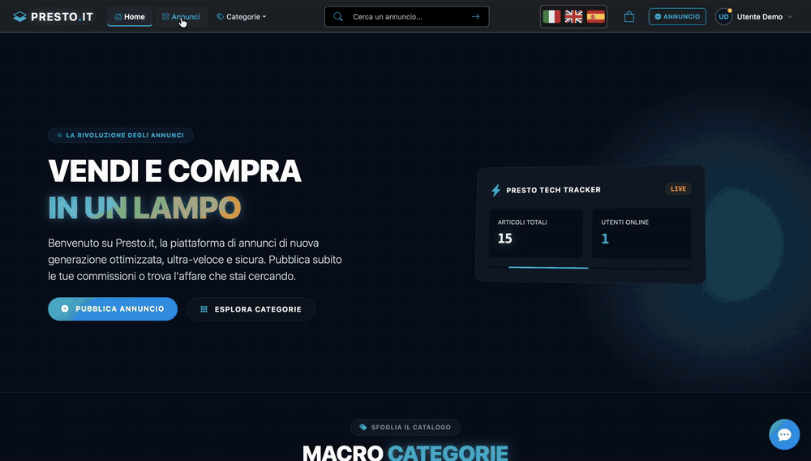
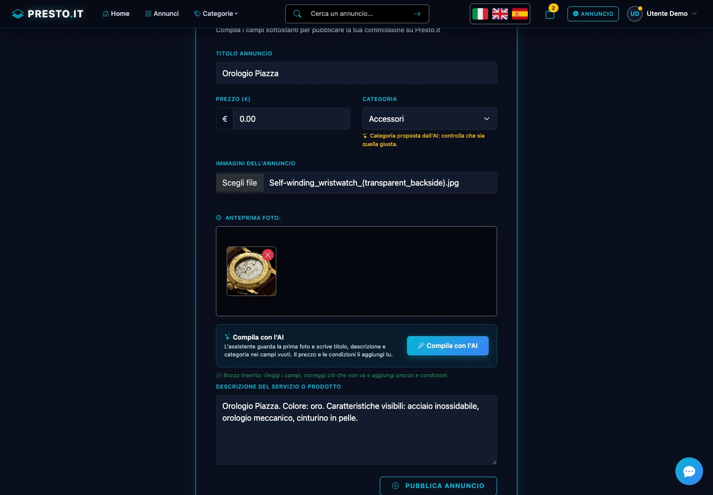
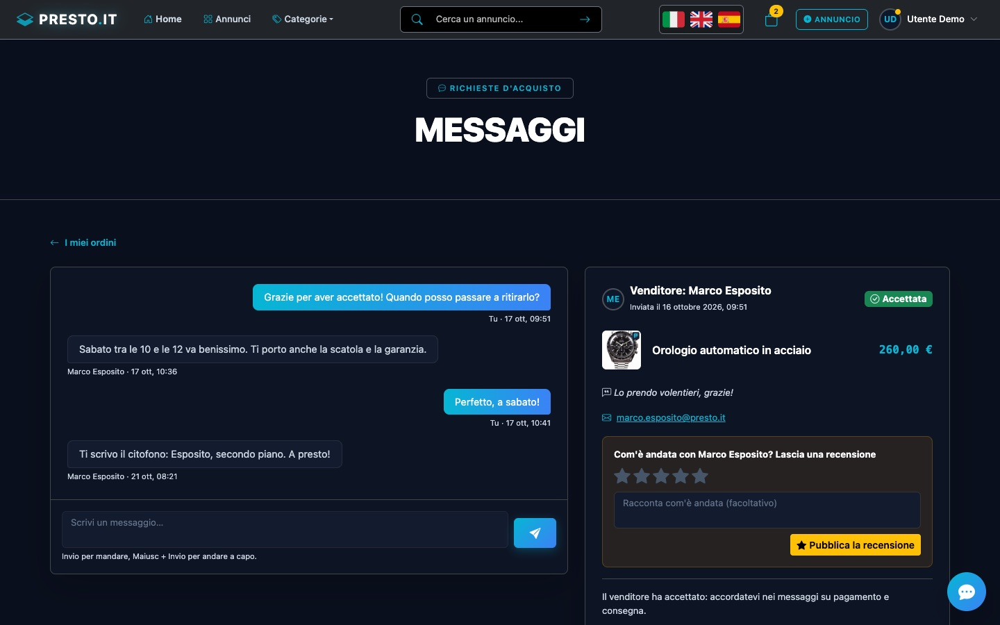
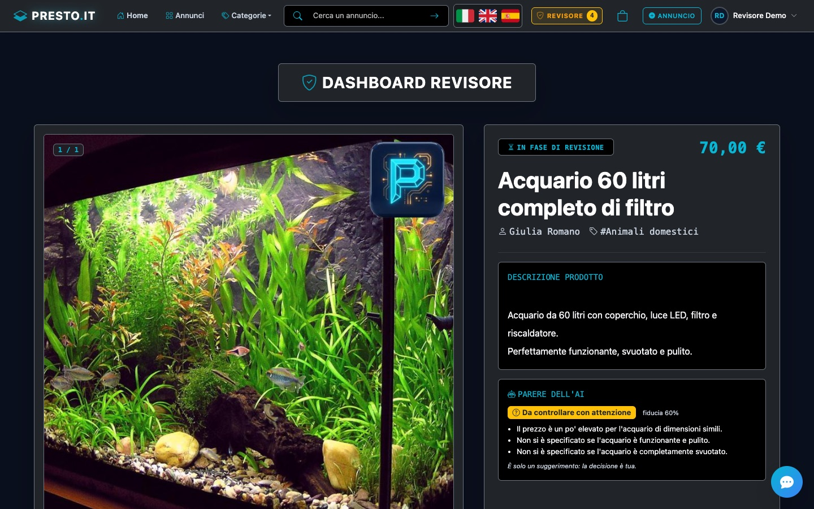
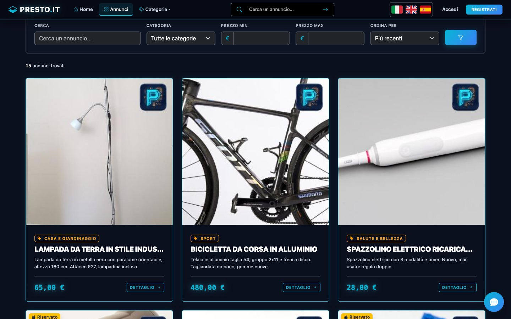
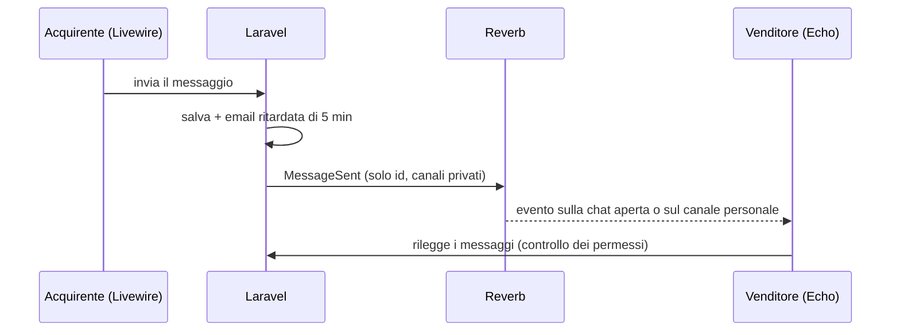
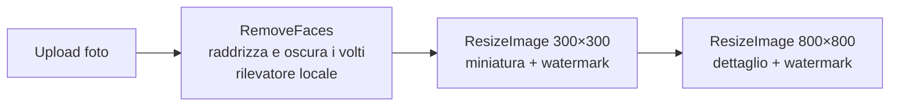
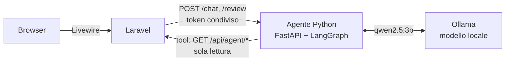

# Presto.it


[](https://github.com/DarioDidonna/presto_dario_didonna/actions/workflows/tests.yml)

**Marketplace di annunci con moderazione umana e analisi delle immagini tramite intelligenza artificiale.**

Ogni annuncio pubblicato da un utente passa da un revisore prima di diventare visibile. Le foto caricate vengono elaborate in background: un rilevatore **locale** oscura i volti e si generano miniature con watermark. Il revisore vede per ogni foto quanti volti sono stati oscurati e, se vuole, chiede un parere all'agente AI.

Un **agente AI** scritto in Python (LangChain/LangGraph) con un **modello locale** servito da Ollama aiuta gli utenti a trovare annunci in linguaggio naturale e dà ai revisori un parere motivato su ogni annuncio, senza chiavi API e funzionando anche offline.

Progetto finale del corso Hackademy (Aulab), ampliato con refactoring, test automatici e nuove funzionalità.

> **In English** — Presto.it is a classifieds marketplace built with **Laravel 13 + Livewire 4**, extended with a
> **Python AI agent (LangChain/LangGraph + FastAPI)** running a **local model on Ollama** (no API keys, works offline):
> a shopping assistant that answers with real listings, an AI opinion for human moderators, and a draft listing written
> from a photo with a vision model, plus local face blurring (OpenCV) on every uploaded photo. It also has a cart with purchase requests, real-time buyer–seller messaging
> (Laravel Reverb), seller reviews, three UI languages and 253 + 125 automated tests, static analysis with Larastan running on GitHub Actions.
> Every AI feature is measured with repeatable evals and guarded by deterministic checks in code.

<p align="center">
  <br>
  <sub>L'assistente risponde con un annuncio vero (modello locale su Ollama) e dalla scheda si aggiunge al carrello. Video accelerato nelle attese.</sub>
</p>

<table>
  <tr>
    <td width="50%"><br><sub><b>Compila con l'AI</b>: bozza dell'annuncio dalla foto, con un modello di visione locale</sub></td>
    <td width="50%"><br><sub><b>Messaggi in tempo reale</b> (Reverb) e recensione del venditore dopo l'acquisto</sub></td>
  </tr>
  <tr>
    <td width="50%"><br><sub><b>Dashboard del revisore</b>: parere dell'AI, decide sempre una persona</sub></td>
    <td width="50%"><br><sub><b>Ricerca e filtri</b>, annunci riservati e carrello</sub></td>
  </tr>
</table>


---

## Funzionalità

### Utenti
- Registrazione, login e **reset della password via email** (Laravel Fortify)
- **Pubblicazione di annunci** con fino a 6 foto, anteprima e validazione in tempo reale (Livewire)
- **Modifica ed eliminazione** dei propri annunci: dopo una modifica l'annuncio torna in revisione
- **Profilo personale**: dati dell'account, foto profilo (ritagliata e ripulita dai metadati EXIF), cambio nome e password, elenco dei propri annunci con lo stato di revisione
- **Ricerca e filtri** nell'elenco annunci: testo (Laravel Scout + TNTSearch, con tolleranza ai refusi e parole parziali nel titolo), categoria, fascia di prezzo e ordinamento per pertinenza, data o prezzo
- **Email con l'esito della revisione** (accettato o rifiutato), inviata in coda e nella lingua dell'utente
- Candidatura per diventare revisore

### Carrello e richieste d'acquisto
- **Carrello** con gli annunci divisi per venditore: si aggiunge dalla pagina dell'annuncio o direttamente dalle schede dell'assistente AI
- **Invio delle richieste d'acquisto**: una richiesta per ogni venditore, con messaggio facoltativo ed email al venditore. Il pagamento si accorda tra le parti, come sui siti di annunci tra privati
- Gli annunci richiesti diventano **riservati** (nessun altro può ordinarli); accettati diventano **venduti** e spariscono dal catalogo, rifiutati o annullati tornano disponibili
- **I miei ordini** (con annullamento finché la richiesta è in attesa) e **Richieste ricevute** per accettare o rifiutare, con email all'acquirente
- Invio in una transazione con **lock sulle righe**: due acquirenti non possono riservare lo stesso annuncio nello stesso istante

### Recensioni dei venditori
- Dopo una vendita **accettata** l'acquirente valuta il venditore da 1 a 5 stelle, con un commento facoltativo: **una sola volta**, garantito anche da un indice unico nel database
- **Pagina pubblica del venditore**: media delle stelle, recensioni e annunci in vendita, senza email né dati personali
- Media e numero di recensioni accanto al venditore nella pagina di ogni annuncio; email al venditore per ogni nuova recensione

### Messaggi in tempo reale
- Ogni richiesta d'acquisto ha la sua **conversazione** tra acquirente e venditore, per accordarsi su ritiro e pagamento
- I messaggi arrivano **senza ricaricare la pagina** (Laravel Reverb + Echo, canali privati autorizzati con la stessa policy della pagina)
- **Contatori dei non letti** nel menu e sulle schede, aggiornati dal vivo anche mentre si è su altre pagine
- **Email solo se serve**: parte dopo 5 minuti, solo se il messaggio è ancora non letto, una per ogni raffica di messaggi
- Se Reverb è spento i messaggi vengono salvati comunque e compaiono ricaricando la pagina



### Revisori
- **Dashboard di revisione** con coda in ordine di arrivo e conferma prima di accettare o rifiutare
- **Annulla l'ultima decisione** entro 5 minuti: l'email all'autore parte solo allo scadere della finestra e solo se la decisione è ancora valida
- Per ogni foto: **quanti volti sono stati oscurati** (o se non sono ancora stati controllati)
- Promozione a revisore tramite **link firmato a tempo** inviato via email all'amministratore

### Elaborazione delle immagini (code)

Ogni foto caricata avvia una catena di job in coda:



**Oscuramento dei volti in locale.** `RemoveFaces` raddrizza la foto secondo l'EXIF (le foto del telefono sono spesso salvate "di lato") e chiede i volti al servizio Python, che usa **YuNet** di OpenCV: modello da 230 KB incluso nel repository, ~20 ms a foto, senza GPU né rete. Misurato con `ai-agent/evals/faces.py`: **24 volti su 25** (manca un profilo con occhiali da sole) e un falso volto in **2 foto di oggetti su 24** (i bottoncini di un mattoncino). Nessuna soglia separa i due casi, quindi si privilegia la privacy (soglia bassa, riquadri allargati del 25%) e il revisore vede per ogni foto quanti volti sono stati oscurati. Se il servizio è spento il job ritenta più tardi; `php artisan app:analyze-images` rimette in coda le foto rimaste da controllare.

### Assistente AI (Python + Laravel)

- **Assistente acquisti**: una chat in tutte le pagine. «Cerco una bici da corsa sotto i 500 euro» → l'agente usa la ricerca e i filtri del sito come *tool* e risponde con **annunci veri**, mostrati come schede cliccabili da cui si aggiunge l'annuncio al carrello. Sa se un annuncio è già riservato. Ricorda la conversazione («e quanto costa?») e risponde in italiano, inglese e spagnolo.
- **Annuncio dalla foto**: nel modulo di inserimento, «Compila con l'AI» guarda la prima foto con un modello di visione locale (`qwen2.5vl:3b`) e riempie titolo, descrizione e categoria, solo nei campi vuoti e mai il prezzo. Il modello dice solo cosa vede; il testo lo compone il codice, così non può contenere prezzi, contatti o misure inventate. La categoria proposta è segnata da controllare.
- **Parere per il revisore**: nella dashboard, «Chiedi un parere» restituisce *accetta / rifiuta / da controllare* con motivi e segnalazioni (contenuti vietati, truffe, contatti personali, foto inadatte). È solo un suggerimento: decide sempre il revisore.



- Il browser non parla mai con il servizio Python; l'agente non accede mai al database: legge solo annunci **pubblicati** tramite API interne protette da token.
- **Difese nel codice, non solo nelle istruzioni**: un modello da 3B parametri non è affidabile da solo. Argomenti dei tool validati e ancorati al messaggio dell'utente, prompt injection bloccato sia nei messaggi sia negli annunci, prezzi e link della risposta verificati sui dati veri, regole di moderazione che prevalgono sul modello.
- **Valutazioni con il modello vero** (`ai-agent/evals/`): assistente acquisti da 6/10 a 29/30 su tre esecuzioni, parere del revisore 8/8, bozza dalla foto con testo senza dati inventati 8/8. Dettagli in [`ai-agent/README.md`](ai-agent/README.md).

### Altro
- Interfaccia in **italiano, inglese e spagnolo** (testi, validazione ed email)
- Tema scuro coerente, layout responsive, attenzione all'accessibilità (testi per screen reader, link "vai al contenuto", `aria-*`)
- Statistiche reali in homepage (annunci pubblicati, utenti online, ultimi annunci)
- **Anteprima nei link condivisi** (Open Graph e Twitter Card): un annuncio incollato su WhatsApp, LinkedIn o Telegram mostra foto, titolo e prezzo

---

## Tecnologie

| Ambito | Strumenti |
|---|---|
| Backend | PHP 8.2+, Laravel 13, Laravel Fortify, Laravel Scout + TNTSearch |
| Frontend | Blade, Livewire 4, Bootstrap 5.3, Bootstrap Icons, Vite (nessuna dipendenza da CDN) |
| Tempo reale | Laravel Reverb (WebSocket), Laravel Echo |
| Immagini | Rilevamento volti in locale (OpenCV YuNet), Spatie Image (GD) |
| Agente AI | Python 3.12 (uv), FastAPI, LangChain + LangGraph, Ollama con `qwen2.5:3b` (testo) e `qwen2.5vl:3b` (visione, facoltativo) in locale |
| Dati | MySQL, code e sessioni su database |
| Test e qualità | PHPUnit (253 test), pytest (125 test), Larastan (PHPStan livello 5), Laravel Pint, ruff, GitHub Actions |

---

## Installazione

**Requisiti:** PHP 8.2+ con estensione GD, Composer, Node.js 20.19+ (o 22.12+), MySQL.

```bash
git clone git@github.com:DarioDidonna/presto_dario_didonna.git
cd presto_dario_didonna

composer install
npm install

cp .env.example .env
php artisan key:generate
```

Configura il database nel file `.env` (`DB_DATABASE`, `DB_USERNAME`, `DB_PASSWORD`), poi:

```bash
php artisan migrate --seed      # in locale crea anche utenti e annunci demo
php artisan storage:link
```

Avvia l'applicazione (server, coda, log, Vite, Reverb per i messaggi in tempo reale e agente AI insieme):

```bash
composer run dev
```

Il sito è su [http://localhost:8000](http://localhost:8000).

### Account demo

| Ruolo | Email | Password |
|---|---|---|
| Utente | `demo@presto.it` | `password` |
| Revisore | `revisore@presto.it` | `password` |

I dati demo comprendono 24 annunci in tutti gli stati (pubblicati, in revisione, rifiutati) e, per l'utente demo, un carrello pronto, richieste d'acquisto in ogni stato (una ricevuta da accettare o rifiutare, una vendita conclusa e ordini accettati, rifiutati e in attesa) conversazioni con messaggi non letti, una recensione ricevuta e un acquisto ancora da recensire.

Per vedere i messaggi in tempo reale apri due browser (o una finestra privata): `demo@presto.it` e `giulia.romano@presto.it`, password `password`.

Per riportare il sito allo stato demo iniziale (database, foto caricate e indice di ricerca da zero) basta un comando, che chiede conferma e non gira in produzione:

```bash
composer run demo
```

Il sito non usa CDN: icone e stili sono inclusi nel build, quindi la demo funziona anche senza connessione, oscuramento dei volti e modelli AI compresi: nessun servizio esterno.

Per usare foto vere al posto delle immagini generate vedi [`database/seeders/demo-images`](database/seeders/demo-images/README.md).

### Assistente AI (facoltativo)

Senza agente il sito funziona normalmente: la chat e il parere del revisore semplicemente non compaiono, e i volti nelle nuove foto restano segnati come «non controllati» finché non lo si avvia (poi `php artisan app:analyze-images`).

1. Installa [Ollama](https://ollama.com) e scarica il modello: `ollama pull qwen2.5:3b` (~2 GB; scelto perché gira bene anche con 8 GB di RAM).
2. Installa [uv](https://docs.astral.sh/uv/): `brew install uv` (installa da solo Python 3.12 e le dipendenze).
3. Configura il token condiviso tra Laravel e l'agente e controlla l'ambiente:
   ```bash
   php artisan app:ai-setup
   ```
4. `composer run dev` avvia anche l'agente (http://127.0.0.1:8001). Se `uv` od Ollama mancano lo segnala, senza fermare il sito.

### Email

In sviluppo le email (reset password, candidature revisore) finiscono nel log (`MAIL_MAILER=log`). Per vederle impaginate puoi usare un servizio come Mailtrap configurando le variabili `MAIL_*`.

---

### Messa in produzione

Parti da `.env.production.example` (copialo in `.env` sul server e compila i valori vuoti):

- `APP_URL` deve essere il dominio vero con `https://`: le richieste con un altro host vengono rifiutate e i link delle email usano questo indirizzo;
- `ADMIN_EMAIL` riceve le richieste per diventare revisore: il link va confermato con un clic, dura 3 giorni e vale una volta;
- la registrazione invia un'email di conferma: senza un `MAIL_MAILER` funzionante nessuno può pubblicare o acquistare. In locale, con `MAIL_MAILER=log`, il link si trova in `storage/logs/laravel.log`;
- dopo l'aggiornamento: `php artisan migrate` e `php artisan app:strip-image-metadata`, che toglie i metadati (GPS compreso) dalle foto caricate in precedenza.

## Comandi utili

| Comando | Descrizione |
|---|---|
| `php artisan test` | Esegue la suite di test |
| `composer run demo` | Riporta il sito allo stato demo (cancella il database locale) |
| `php artisan app:ai-setup` | Configura il token dell'agente AI e controlla uv, Ollama e modello |
| `cd ai-agent && uv run python evals/shopping.py` | Valuta l'assistente acquisti con il modello vero (anche `evals/review.py`) |
| `php artisan app:make-user-revisor {email}` | Rende revisore un utente |
| `php artisan app:analyze-images [--all]` | Rimette in coda l'analisi delle immagini (solo quelle mai analizzate, o tutte) |
| `php artisan scout:import "App\Models\Article"` | Ricostruisce l'indice di ricerca |
| `php artisan queue:work` | Avvia il worker delle code (già incluso in `composer run dev`) |
| `php artisan reverb:start` | Avvia il server WebSocket dei messaggi sulla porta 8080 (già incluso in `composer run dev`) |

---

## Test

```bash
php artisan test
```

I 253 test Laravel coprono, tra l'altro:

- **sicurezza e permessi**: solo i revisori approvano, link di promozione firmati e a scadenza, annunci non pubblicati invisibili agli altri utenti, modifica ed eliminazione riservate all'autore;
- **flussi completi**: ricerca e filtri, pubblicazione, revisione con email all'autore e annullamento, reset password, profilo e foto profilo, catena di elaborazione delle immagini, oscuramento dei volti (riquadri, tentativi con il servizio spento, tutte le 8 orientazioni EXIF);
- **recensioni**: solo l'acquirente di una vendita accettata e una sola volta, errori di validazione sotto il modulo giusto, media calcolata correttamente, pagina pubblica senza dati privati;
- **messaggi**: solo acquirente e venditore leggono e scrivono, conversazione chiusa dopo rifiuto o annullamento, evento trasmesso sui canali giusti senza il testo, contatori dei non letti, email ritardata e saltata se il messaggio è stato letto;
- **carrello e richieste d'acquisto**: niente annunci propri, riservati o venduti nel carrello, una richiesta per venditore, accetta/rifiuta/annulla solo da chi ne ha diritto e solo se ancora in attesa, email alle due parti;
- **pagine di errore** 403, 404, 419, 429, 500 e 503 nella lingua dell'utente;
- **SEO e condivisione**: meta tag Open Graph per pagina, foto e prezzo dell'annuncio;
- **assistente AI**: API interne protette da token e senza dati personali, chat e parere del revisore con l'agente simulato (schede solo di annunci pubblicati, agente spento, limiti di utilizzo);
- **qualità**: limite di query per pagina (contro i problemi N+1), HTML bilanciato, nessuna classe CSS non definita, nessun link morto, testi tradotti.

I test usano un database SQLite in memoria e il driver Scout `collection`: non toccano il database né l'indice di ricerca di sviluppo.

L'agente Python ha 125 test propri (`cd ai-agent && uv run pytest`) con un modello e un Laravel finti: tool, difese contro il prompt injection, memoria della conversazione, regole di moderazione, endpoint e autenticazione.

A ogni push e pull request **GitHub Actions** esegue le due suite (quella Laravel con il build del front-end), l'**analisi statica** con [Larastan](https://github.com/larastan/larastan) e controlla lo stile del codice con [Laravel Pint](https://laravel.com/docs/pint) e [ruff](https://docs.astral.sh/ruff/): vedi [`.github/workflows/tests.yml`](.github/workflows/tests.yml). In locale: `composer analyse`, `vendor/bin/pint` e `cd ai-agent && uv run ruff format .`.

**Analisi statica.** Larastan (PHPStan per Laravel) al livello 5, configurato in [`phpstan.neon`](phpstan.neon), su `app`, `routes` e `database`: zero errori, senza baseline né soppressioni. Introdurlo ha richiesto di dichiarare i tipi delle relazioni Eloquent (`BelongsTo<User, $this>`) e ha trovato un bug vero: il prezzo era un `float` a **precisione singola** (`float('price', 8, 2)`, dove dal Laravel 11 il terzo argomento è ignorato), quindi 999.999,99 €, il massimo ammesso dal modulo, veniva salvato come 1.000.000 €. Ora è `decimal(10,2)`, con un test.

---

## Struttura del codice

```
app/
├── Console/Commands/        app:make-user-revisor, app:analyze-images, app:demo-reset, app:ai-setup
├── Events/                  MessageSent (trasmesso con Reverb)
├── Http/Controllers/        Article, Public, Revisor, Profile, Cart, PurchaseRequest, Sales, Conversation,
│                            Review, Seller
│                            (+ Api/AgentController per l'agente)
├── Http/Requests/           UpdateAvatarRequest, StoreReviewRequest (Form Request)
├── Jobs/                    RemoveFaces (volti, servizio locale), ResizeImage (miniature con watermark)
├── Livewire/                CreateArticleForm, EditArticleForm (+ Forms/ArticleForm, Concerns/HandlesArticleForm),
│                            ShoppingAssistant (chat), ReviewAssistant (parere AI), Conversation (messaggi)
├── Models/                  Article, Category, Image, User, PurchaseRequest, PurchaseRequestItem, Message, Review
├── Notifications/           ArticleReviewed, PurchaseRequested, PurchaseRequestAnswered, PurchaseRequestCancelled, NewMessage,
│                            ReviewReceived
├── Policies/                ArticlePolicy (vedere, modificare, eliminare, mettere nel carrello), PurchaseRequestPolicy
├── Services/                AiAgentClient (servizio Python), Checkout e PurchaseRequestWorkflow (richieste d'acquisto)
├── Support/                 ArticleFilters (ricerca e filtri dell'elenco)
└── View/Composers/          Statistiche della homepage
resources/views/             Pagine Blade e componenti (layout, card, avatar, navbar…)
lang/{it,en,es}/             Traduzioni dell'interfaccia e della validazione
routes/api.php               API interne per l'agente (/api/agent/*)
routes/channels.php          Canali privati di Reverb (conversazioni, utente)
tests/Feature/               Test di funzionalità
ai-agent/                    Servizio Python dell'agente AI
├── src/presto_ai_agent/     app (FastAPI), agent (LangGraph), tools, guardrails, review, laravel_client
├── tests/                   pytest con modello e Laravel finti
└── evals/                   valutazioni con il modello vero
```

---

## Autore

**Dario Didonna** — [GitHub](https://github.com/DarioDidonna)

## Licenza

Codice rilasciato con licenza [MIT](LICENSE). Fanno eccezione, con le rispettive licenze:
- le foto demo in `database/seeders/demo-images/` (Wikimedia Commons: autori e licenze in [`CREDITS.md`](database/seeders/demo-images/CREDITS.md));
- il modello YuNet in `ai-agent/src/presto_ai_agent/models/` (MIT, [`LICENSE-yunet`](ai-agent/src/presto_ai_agent/models/LICENSE-yunet)).

