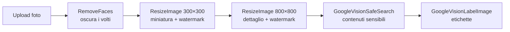
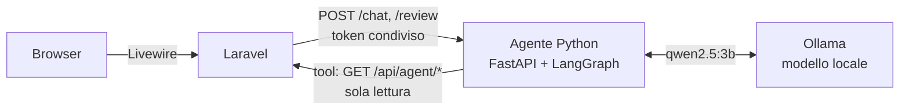

# Presto.it

**Marketplace di annunci con moderazione umana e analisi delle immagini tramite intelligenza artificiale.**

Ogni annuncio pubblicato da un utente passa da un revisore prima di diventare visibile. Le foto caricate vengono elaborate in background: i volti vengono oscurati, si generano miniature con watermark e Google Cloud Vision fornisce etichette e una valutazione dei contenuti sensibili per aiutare il revisore a decidere.

Un **agente AI** scritto in Python (LangChain/LangGraph) con un **modello locale** servito da Ollama aiuta gli utenti a trovare annunci in linguaggio naturale e dà ai revisori un parere motivato su ogni annuncio, senza chiavi API e funzionando anche offline.

Progetto finale del corso Hackademy (Aulab), ampliato con refactoring, test automatici e nuove funzionalità.

<!--
  SCREENSHOT: aggiungi le immagini in docs/screenshots/ e togli questo commento.

  <p align="center">
    
    
  </p>
-->


[](https://github.com/DarioDidonna/presto_dario_didonna/actions/workflows/tests.yml)

---

## Funzionalità

### Utenti
- Registrazione, login e **reset della password via email** (Laravel Fortify)
- **Pubblicazione di annunci** con fino a 6 foto, anteprima e validazione in tempo reale (Livewire)
- **Modifica ed eliminazione** dei propri annunci: dopo una modifica l'annuncio torna in revisione
- **Profilo personale**: dati dell'account, foto profilo (ritagliata e ripulita dai metadati EXIF), cambio nome e password, elenco dei propri annunci con lo stato di revisione
- **Ricerca e filtri** nell'elenco annunci: testo (Laravel Scout + TNTSearch, con tolleranza ai refusi e parole parziali nel titolo), categoria, fascia di prezzo e ordinamento per pertinenza, data o prezzo
- **Email con l'esito della revisione** (accettato o rifiutato), inviata in coda e nella lingua dell'utente
- Candidatura per diventare revisore

### Carrello e richieste d'acquisto
- **Carrello** con gli annunci divisi per venditore: si aggiunge dalla pagina dell'annuncio o direttamente dalle schede dell'assistente AI
- **Invio delle richieste d'acquisto**: una richiesta per ogni venditore, con messaggio facoltativo ed email al venditore. Il pagamento si accorda tra le parti, come sui siti di annunci tra privati
- Gli annunci richiesti diventano **riservati** (nessun altro può ordinarli); accettati diventano **venduti** e spariscono dal catalogo, rifiutati o annullati tornano disponibili
- **I miei ordini** (con annullamento finché la richiesta è in attesa) e **Richieste ricevute** per accettare o rifiutare, con email all'acquirente
- Invio in una transazione con **lock sulle righe**: due acquirenti non possono riservare lo stesso annuncio nello stesso istante

### Revisori
- **Dashboard di revisione** con coda in ordine di arrivo e conferma prima di accettare o rifiutare
- **Annulla l'ultima decisione** entro 5 minuti: l'email all'autore parte solo allo scadere della finestra e solo se la decisione è ancora valida
- Per ogni foto: **etichette** e **valutazioni SafeSearch** (adulti, violenza, contenuti espliciti…) di Google Vision
- Promozione a revisore tramite **link firmato a tempo** inviato via email all'amministratore

### Elaborazione delle immagini (code)

Ogni foto caricata avvia una catena di job in coda:



Un errore di Google Vision (credenziali mancanti, servizio non raggiungibile) non blocca la catena: le miniature vengono generate comunque e la dashboard del revisore segnala l'analisi mancante.

### Assistente AI (Python + Laravel)

- **Assistente acquisti**: una chat in tutte le pagine. «Cerco una bici da corsa sotto i 500 euro» → l'agente usa la ricerca e i filtri del sito come *tool* e risponde con **annunci veri**, mostrati come schede cliccabili da cui si aggiunge l'annuncio al carrello. Sa se un annuncio è già riservato. Ricorda la conversazione («e quanto costa?») e risponde in italiano, inglese e spagnolo.
- **Parere per il revisore**: nella dashboard, «Chiedi un parere» restituisce *accetta / rifiuta / da controllare* con motivi e segnalazioni (contenuti vietati, truffe, contatti personali, foto inadatte). È solo un suggerimento: decide sempre il revisore.



- Il browser non parla mai con il servizio Python; l'agente non accede mai al database: legge solo annunci **pubblicati** tramite API interne protette da token.
- **Difese nel codice, non solo nelle istruzioni**: un modello da 3B parametri non è affidabile da solo. Argomenti dei tool validati e ancorati al messaggio dell'utente, prompt injection bloccato sia nei messaggi sia negli annunci, prezzi e link della risposta verificati sui dati veri, regole di moderazione che prevalgono sul modello.
- **Valutazioni con il modello vero** (`ai-agent/evals/`): assistente acquisti da 6/10 a 29/30 su tre esecuzioni, parere del revisore 8/8. Dettagli in [`ai-agent/README.md`](ai-agent/README.md).

### Altro
- Interfaccia in **italiano, inglese e spagnolo** (testi, validazione ed email)
- Tema scuro coerente, layout responsive, attenzione all'accessibilità (testi per screen reader, link "vai al contenuto", `aria-*`)
- Statistiche reali in homepage (annunci pubblicati, utenti online, ultimi annunci)
- **Anteprima nei link condivisi** (Open Graph e Twitter Card): un annuncio incollato su WhatsApp, LinkedIn o Telegram mostra foto, titolo e prezzo

---

## Tecnologie

| Ambito | Strumenti |
|---|---|
| Backend | PHP 8.2+, Laravel 13, Laravel Fortify, Laravel Scout + TNTSearch |
| Frontend | Blade, Livewire 4, Bootstrap 5.3, Bootstrap Icons, Vite (nessuna dipendenza da CDN) |
| Immagini | Google Cloud Vision API, Spatie Image (GD) |
| Agente AI | Python 3.12 (uv), FastAPI, LangChain + LangGraph, Ollama con `qwen2.5:3b` in locale |
| Dati | MySQL, code e sessioni su database |
| Test e qualità | PHPUnit (204 test), pytest (94 test), Laravel Pint, ruff, GitHub Actions |

---

## Installazione

**Requisiti:** PHP 8.2+ con estensione GD, Composer, Node.js 20.19+ (o 22.12+), MySQL.

```bash
git clone git@github.com:DarioDidonna/presto_dario_didonna.git
cd presto_dario_didonna

composer install
npm install

cp .env.example .env
php artisan key:generate
```

Configura il database nel file `.env` (`DB_DATABASE`, `DB_USERNAME`, `DB_PASSWORD`), poi:

```bash
php artisan migrate --seed      # in locale crea anche utenti e annunci demo
php artisan storage:link
```

Avvia l'applicazione (server, coda, log e Vite insieme):

```bash
composer run dev
```

Il sito è su [http://localhost:8000](http://localhost:8000).

### Account demo

| Ruolo | Email | Password |
|---|---|---|
| Utente | `demo@presto.it` | `password` |
| Revisore | `revisore@presto.it` | `password` |

I dati demo comprendono 24 annunci in tutti gli stati (pubblicati, in revisione, rifiutati) e, per l'utente demo, un carrello pronto e richieste d'acquisto in ogni stato: una ricevuta da accettare o rifiutare, una vendita conclusa e ordini accettati, rifiutati e in attesa.

Per riportare il sito allo stato demo iniziale (database, foto caricate e indice di ricerca da zero) basta un comando, che chiede conferma e non gira in produzione:

```bash
composer run demo
```

Il sito non usa CDN: icone e stili sono inclusi nel build, quindi la demo funziona anche senza connessione (tranne l'analisi di Google Vision).

Per usare foto vere al posto delle immagini generate vedi [`database/seeders/demo-images`](database/seeders/demo-images/README.md).

### Google Cloud Vision (facoltativo)

Senza credenziali il sito funziona: solo l'oscuramento dei volti e l'analisi delle foto vengono saltati.

1. Crea un service account con la **Cloud Vision API** abilitata e scarica la chiave JSON.
2. Salvala come `google_credential.json` nella root del progetto (il file è già in `.gitignore`), oppure indica il percorso in `GOOGLE_VISION_CREDENTIALS` nel `.env`.
3. Analizza le immagini già presenti: `php artisan app:analyze-images`.

### Assistente AI (facoltativo)

Senza agente il sito funziona normalmente: la chat e il parere del revisore semplicemente non compaiono.

1. Installa [Ollama](https://ollama.com) e scarica il modello: `ollama pull qwen2.5:3b` (~2 GB; scelto perché gira bene anche con 8 GB di RAM).
2. Installa [uv](https://docs.astral.sh/uv/): `brew install uv` (installa da solo Python 3.12 e le dipendenze).
3. Configura il token condiviso tra Laravel e l'agente e controlla l'ambiente:
   ```bash
   php artisan app:ai-setup
   ```
4. `composer run dev` avvia anche l'agente (http://127.0.0.1:8001). Se `uv` od Ollama mancano lo segnala, senza fermare il sito.

### Email

In sviluppo le email (reset password, candidature revisore) finiscono nel log (`MAIL_MAILER=log`). Per vederle impaginate puoi usare un servizio come Mailtrap configurando le variabili `MAIL_*`.

---

## Comandi utili

| Comando | Descrizione |
|---|---|
| `php artisan test` | Esegue la suite di test |
| `composer run demo` | Riporta il sito allo stato demo (cancella il database locale) |
| `php artisan app:ai-setup` | Configura il token dell'agente AI e controlla uv, Ollama e modello |
| `cd ai-agent && uv run python evals/shopping.py` | Valuta l'assistente acquisti con il modello vero (anche `evals/review.py`) |
| `php artisan app:make-user-revisor {email}` | Rende revisore un utente |
| `php artisan app:analyze-images [--all]` | Rimette in coda l'analisi delle immagini (solo quelle mai analizzate, o tutte) |
| `php artisan scout:import "App\Models\Article"` | Ricostruisce l'indice di ricerca |
| `php artisan queue:work` | Avvia il worker delle code (già incluso in `composer run dev`) |

---

## Test

```bash
php artisan test
```

I 204 test Laravel coprono, tra l'altro:

- **sicurezza e permessi**: solo i revisori approvano, link di promozione firmati e a scadenza, annunci non pubblicati invisibili agli altri utenti, modifica ed eliminazione riservate all'autore;
- **flussi completi**: ricerca e filtri, pubblicazione, revisione con email all'autore e annullamento, reset password, profilo e foto profilo, catena di elaborazione delle immagini;
- **carrello e richieste d'acquisto**: niente annunci propri, riservati o venduti nel carrello, una richiesta per venditore, accetta/rifiuta/annulla solo da chi ne ha diritto e solo se ancora in attesa, email alle due parti;
- **pagine di errore** 403, 404, 419, 429, 500 e 503 nella lingua dell'utente;
- **SEO e condivisione**: meta tag Open Graph per pagina, foto e prezzo dell'annuncio;
- **assistente AI**: API interne protette da token e senza dati personali, chat e parere del revisore con l'agente simulato (schede solo di annunci pubblicati, agente spento, limiti di utilizzo);
- **qualità**: limite di query per pagina (contro i problemi N+1), HTML bilanciato, nessuna classe CSS non definita, nessun link morto, testi tradotti.

I test usano un database SQLite in memoria e il driver Scout `collection`: non toccano il database né l'indice di ricerca di sviluppo.

L'agente Python ha 94 test propri (`cd ai-agent && uv run pytest`) con un modello e un Laravel finti: tool, difese contro il prompt injection, memoria della conversazione, regole di moderazione, endpoint e autenticazione.

A ogni push e pull request **GitHub Actions** esegue le due suite (quella Laravel con il build del front-end) e controlla lo stile del codice con [Laravel Pint](https://laravel.com/docs/pint) e [ruff](https://docs.astral.sh/ruff/): vedi [`.github/workflows/tests.yml`](.github/workflows/tests.yml). Per formattare il codice in locale: `vendor/bin/pint` e `cd ai-agent && uv run ruff format .`.

---

## Struttura del codice

```
app/
├── Console/Commands/        app:make-user-revisor, app:analyze-images, app:demo-reset, app:ai-setup
├── Http/Controllers/        Article, Public, Revisor, Profile, Cart, PurchaseRequest, Sales
│                            (+ Api/AgentController per l'agente)
├── Http/Requests/           UpdateAvatarRequest (Form Request)
├── Jobs/                    RemoveFaces, ResizeImage, GoogleVision* (+ Concerns/CallsGoogleVision)
├── Livewire/                CreateArticleForm, EditArticleForm (+ Forms/ArticleForm, Concerns/HandlesArticleForm),
│                            ShoppingAssistant (chat), ReviewAssistant (parere AI)
├── Models/                  Article, Category, Image, User, PurchaseRequest, PurchaseRequestItem
├── Notifications/           ArticleReviewed, PurchaseRequested, PurchaseRequestAnswered, PurchaseRequestCancelled
├── Policies/                ArticlePolicy (vedere, modificare, eliminare, mettere nel carrello), PurchaseRequestPolicy
├── Services/                AiAgentClient (servizio Python), Checkout e PurchaseRequestWorkflow (richieste d'acquisto)
├── Support/                 ArticleFilters (ricerca e filtri dell'elenco)
└── View/Composers/          Statistiche della homepage
resources/views/             Pagine Blade e componenti (layout, card, avatar, navbar…)
lang/{it,en,es}/             Traduzioni dell'interfaccia e della validazione
routes/api.php               API interne per l'agente (/api/agent/*)
tests/Feature/               Test di funzionalità
ai-agent/                    Servizio Python dell'agente AI
├── src/presto_ai_agent/     app (FastAPI), agent (LangGraph), tools, guardrails, review, laravel_client
├── tests/                   pytest con modello e Laravel finti
└── evals/                   valutazioni con il modello vero
```

---

## Autore

**Dario Didonna** — [GitHub](https://github.com/DarioDidonna)
