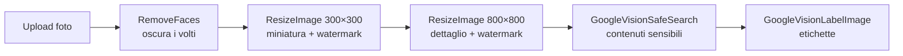

# Presto.it

**Marketplace di annunci con moderazione umana e analisi delle immagini tramite intelligenza artificiale.**

Ogni annuncio pubblicato da un utente passa da un revisore prima di diventare visibile. Le foto caricate vengono elaborate in background: i volti vengono oscurati, si generano miniature con watermark e Google Cloud Vision fornisce etichette e una valutazione dei contenuti sensibili per aiutare il revisore a decidere.

Progetto finale del corso Hackademy (Aulab), ampliato con refactoring, test automatici e nuove funzionalità.

<!--
  SCREENSHOT: aggiungi le immagini in docs/screenshots/ e togli questo commento.

  <p align="center">
    
    
  </p>
-->


---

## Funzionalità

### Utenti
- Registrazione, login e **reset della password via email** (Laravel Fortify)
- **Pubblicazione di annunci** con fino a 6 foto, anteprima e validazione in tempo reale (Livewire)
- **Modifica ed eliminazione** dei propri annunci: dopo una modifica l'annuncio torna in revisione
- **Profilo personale**: dati dell'account, foto profilo (ritagliata e ripulita dai metadati EXIF), cambio nome e password, elenco dei propri annunci con lo stato di revisione
- **Ricerca full-text** (Laravel Scout + TNTSearch) e navigazione per categoria
- Candidatura per diventare revisore

### Revisori
- **Dashboard di revisione** con coda in ordine di arrivo e conferma prima di accettare o rifiutare
- Per ogni foto: **etichette** e **valutazioni SafeSearch** (adulti, violenza, contenuti espliciti…) di Google Vision
- Promozione a revisore tramite **link firmato a tempo** inviato via email all'amministratore

### Elaborazione delle immagini (code)

Ogni foto caricata avvia una catena di job in coda:



Un errore di Google Vision (credenziali mancanti, servizio non raggiungibile) non blocca la catena: le miniature vengono generate comunque e la dashboard del revisore segnala l'analisi mancante.

### Altro
- Interfaccia in **italiano, inglese e spagnolo** (testi, validazione ed email)
- Tema scuro coerente, layout responsive, attenzione all'accessibilità (testi per screen reader, link "vai al contenuto", `aria-*`)
- Statistiche reali in homepage (annunci pubblicati, utenti online, ultimi annunci)

---

## Tecnologie

| Ambito | Strumenti |
|---|---|
| Backend | PHP 8.2+, Laravel 13, Laravel Fortify, Laravel Scout + TNTSearch |
| Frontend | Blade, Livewire 4, Bootstrap 5.3, Bootstrap Icons, Vite |
| Immagini | Google Cloud Vision API, Spatie Image (GD) |
| Dati | MySQL, code e sessioni su database |
| Test | PHPUnit (99 test) |

---

## Installazione

**Requisiti:** PHP 8.2+ con estensione GD, Composer, Node.js 20.19+ (o 22.12+), MySQL.

```bash
git clone git@github.com:DarioDidonna/presto_dario_didonna.git
cd presto_dario_didonna

composer install
npm install

cp .env.example .env
php artisan key:generate
```

Configura il database nel file `.env` (`DB_DATABASE`, `DB_USERNAME`, `DB_PASSWORD`), poi:

```bash
php artisan migrate --seed      # in locale crea anche utenti e annunci demo
php artisan storage:link
```

Avvia l'applicazione (server, coda, log e Vite insieme):

```bash
composer run dev
```

Il sito è su [http://localhost:8000](http://localhost:8000).

### Account demo

| Ruolo | Email | Password |
|---|---|---|
| Utente | `demo@presto.it` | `password` |
| Revisore | `revisore@presto.it` | `password` |

I dati demo comprendono 24 annunci in tutti gli stati (pubblicati, in revisione, rifiutati). Si possono ricaricare con `php artisan db:seed --class=DemoSeeder`; per usare foto vere al posto delle immagini generate vedi [`database/seeders/demo-images`](database/seeders/demo-images/README.md).

### Google Cloud Vision (facoltativo)

Senza credenziali il sito funziona: solo l'oscuramento dei volti e l'analisi delle foto vengono saltati.

1. Crea un service account con la **Cloud Vision API** abilitata e scarica la chiave JSON.
2. Salvala come `google_credential.json` nella root del progetto (il file è già in `.gitignore`), oppure indica il percorso in `GOOGLE_VISION_CREDENTIALS` nel `.env`.
3. Analizza le immagini già presenti: `php artisan app:analyze-images`.

### Email

In sviluppo le email (reset password, candidature revisore) finiscono nel log (`MAIL_MAILER=log`). Per vederle impaginate puoi usare un servizio come Mailtrap configurando le variabili `MAIL_*`.

---

## Comandi utili

| Comando | Descrizione |
|---|---|
| `php artisan test` | Esegue la suite di test |
| `php artisan app:make-user-revisor {email}` | Rende revisore un utente |
| `php artisan app:analyze-images [--all]` | Rimette in coda l'analisi delle immagini (solo quelle mai analizzate, o tutte) |
| `php artisan scout:import "App\Models\Article"` | Ricostruisce l'indice di ricerca |
| `php artisan queue:work` | Avvia il worker delle code (già incluso in `composer run dev`) |

---

## Test

```bash
php artisan test
```

I 99 test coprono, tra l'altro:

- **sicurezza e permessi**: solo i revisori approvano, link di promozione firmati e a scadenza, annunci non pubblicati invisibili agli altri utenti, modifica ed eliminazione riservate all'autore;
- **flussi completi**: pubblicazione, revisione, reset password, profilo e foto profilo, catena di elaborazione delle immagini;
- **qualità**: limite di query per pagina (contro i problemi N+1), HTML bilanciato, nessuna classe CSS non definita, nessun link morto, testi tradotti.

I test usano un database SQLite in memoria e il driver Scout `collection`: non toccano il database né l'indice di ricerca di sviluppo.

---

## Struttura del codice

```
app/
├── Console/Commands/        app:make-user-revisor, app:analyze-images
├── Http/Controllers/        Article, Public, Revisor, Profile
├── Jobs/                    RemoveFaces, ResizeImage, GoogleVision* (+ Concerns/CallsGoogleVision)
├── Livewire/                CreateArticleForm, EditArticleForm (+ Concerns/HandlesArticleForm)
├── Models/                  Article, Category, Image, User
├── Policies/                ArticlePolicy (chi vede, modifica ed elimina un annuncio)
└── View/Composers/          Statistiche della homepage
resources/views/             Pagine Blade e componenti (layout, card, avatar, navbar…)
lang/{it,en,es}/             Traduzioni dell'interfaccia e della validazione
tests/Feature/               Test di funzionalità
```

---

## Autore

**Dario Didonna** — [GitHub](https://github.com/DarioDidonna)
